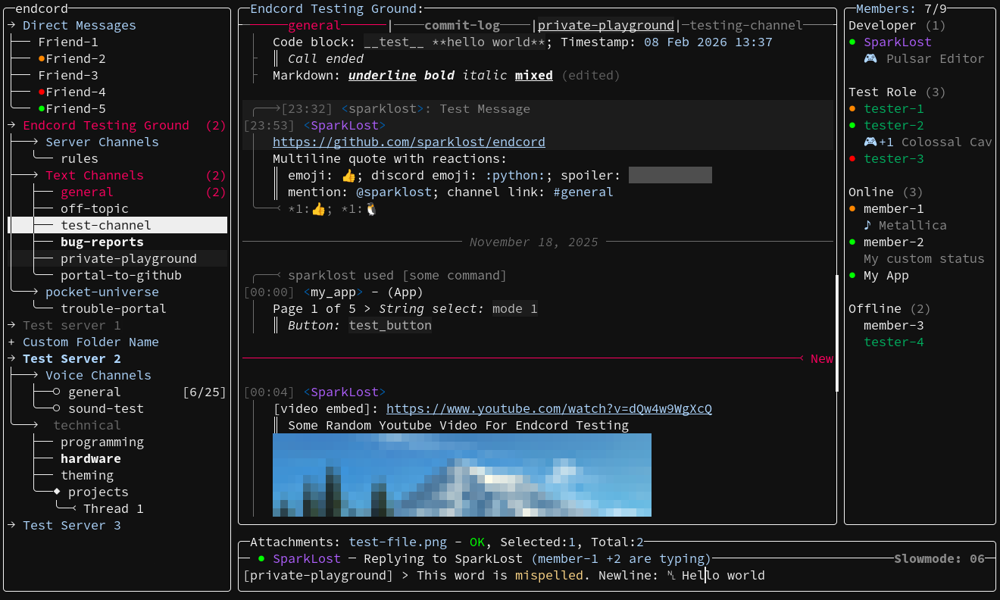

<h1>Endcord</h1>
<a href="https://github.com/sparklost/endcord?tab=readme-ov-file#features">Features</a> |
<a href="https://github.com/sparklost/endcord/blob/main/.github/screenshots.md">Screenshots</a> |
<a href="https://github.com/sparklost/endcord/blob/main/docs/wiki.md">Wiki</a> |
<a href="https://github.com/sparklost/endcord/blob/main/docs/configuration.md">Config</a> |
<a href="https://github.com/sparklost/endcord?tab=readme-ov-file#installing">Installing</a> |
<a href="https://github.com/sparklost/endcord?tab=readme-ov-file#building">Building</a> |
<a href="https://github.com/sparklost/endcord/blob/main/docs/extensions.md">Extensions</a> |
<a href="https://github.com/sparklost/endcord/blob/main/.github/CONTRIBUTING.md">Contributing</a> |
<a href="https://github.com/sparklost/endcord/blob/main/docs/faq.md">FAQ</a> |
<a href="https://discord.gg/judQSxw5K2">Discord</a>

Endcord is a third-party feature rich Discord client, running entirely in terminal (or in its own GTK3 window).  
It is built with Python (this [doesn't mean its slow](docs/faq.md#note-on-python-performance-misconceptions)) and ncurses library, to deliver lightweight yet feature rich experience.  
[More screenshots](https://github.com/sparklost/endcord/blob/main/.github/screenshots.md).  
Official endcord will always stay **purely human project**.  
Endcord is source-available licensed, and thus not open source, more details [here](docs/faq.md#source-available-license). You are not allowed to create public fork that modifies the code.  
Any third party endcord forks may add features that can lead to account ban, cause instability, contain outdated or even malicious code, so it is strongly recommended to avoid them.

## Features
- Extremely low CPU and RAM usage (see [RAM usage](docs/faq.md#ram-usage))
- Voice and video calls (DM, groups and servers) with video streaming
- Vim-mode
- Integrated RPC (only Rich Presence) and game detection
- Mouse controls
- Kitty protocol images, pfp, emoji (through extensions: [1](https://github.com/sparklost/endcord-image-inline), [2](https://github.com/sparklost/endcord-image-pfp), [3](https://github.com/sparklost/endcord-image-emoji))
- Login with email, 2fa, QR code, or paste token
- Desktop notifications
- Inline images (pixelated/ascii-art/[kitty-protocol](https://github.com/sparklost/endcord-image-inline))
- View images, gifs, videos, audio, stickers and YouTube with ASCII art or in external app
- Download/upload attachments
- Select message and: reply, edit, delete, go to replied, react, vote in a poll...
- Member list (toggleable)
- Search messages
- Many more features as [client commands](docs/usage.md#client-commands) with history, custom commands can be bound to key
- App commands and some interactions
- View user profile
- Channel tree (toggleable)
    - Don't show hidden channels
    - Show muted channels as gray
    - Show unread channels as bold
    - Show channels with mention as red with number of mentions
    - Collapse categories and servers
    - DMs in separate drop-down, show DM status
    - Forums, imageborads and thread channels
    - Folders (can be renamed)
- Show reactions, replied message, forwarded message
- Show embeds, attachment types and links, code blocks (with syntax highlighting)
- Spellchecking
- Advanced input line operations and ability to use external editor
- Configurable bar or block shaped cursor
- Tabs and temporary tabs with mouse controls (click, double click, middle click)
- Assist when typing channel/username/role/emoji/sticker
- Search, preview and send gifs
- Record and send voice messages
- `s/old/new` replacement with extended regex
- Unlimited chat scrolling
- Keep deleted messages (OFF by default)
- Highlight messages with mentions
- Show who is typing and send 'typing' (ON by default)
- Change status and custom status
- Copy message text/url to clipboard
- Block/ignore/unblock, hide or mask blocked/ignored users messages
- No ghost pings (when client is running)
- Role colors in chat
- Change server/channel/category notification settings
- Partial markdown support (underline, bold, italic, spoiler, quote)
- Generate server invite link
- Theming
- Customizable status, title and prompt lines
- Customizable chat lines (message, newline, reaction, reply)
- Customizable colors and ASCII art
- Show discord emoji as `:emoji_name:` and view them in media player
- Show mentions as `@username`, `@role`, `#channel_name`
- Channel chat caching
- Extension API, builtin extensions search
- Macro keybindings support (bind key to chain of commands)
- Proxy support
- Profile manager for multiple accounts
- Store token in system keyring
- Works in termux, with android notifications
- Automatic endcord and extensions check for updates
- Headless mode
- Run bots, with interactions
- Lots of easter eggs
- Endcord-GUI features
    - Customizable tray icons, window can be minimized to tray
    - All bindings work, Ctrl+C, Ctrl+Z, Shift+Enter
    - Window can be transparent, and background colors can also have alpha value
    - Uses only 15MB (linux) more RAM (vs most terminals using 20-100MB)
    - GTK-native pasting and drag n' drop (text and files)
    - Linux desktop integration: app icon, notification count badge, click on notification

## Disclaimer
> [!WARNING]
> Using third-party client is against Discord's Terms of Service and may cause your account to be banned!  
> **Use endcord at your own risk!**  
> For more info see [FAQ](docs/faq.md).

## Installing
### Linux
- Install script (**recommended**)
    - `bash -c "$(curl -fsSL https://raw.githubusercontent.com/sparklost/endcord/main/tools/install.sh)"`
    - The script interactively manages multiple installations, install/build/modify/uninstall
- Pre-built binaries are available in releases  
    Binaries are built on Ubuntu-like distro with `--custom-python --nuitka` build script options with clang, meaning they are maximally optimized.
- Arch Linux (AUR):
    - `yay -S endcord-installer` - same install script as explained above
    - `yay -S endcord` - full version with media support, larger executable
    - `yay -S endcord-lite` - lite version without voice calls and media support
    - `yay -S endcord-gui` - "gui" windowed version using GTK3
    - `-git` versions will build from source, with latest changes
- [Build](#building) endcord, then copy built executable to system:  
    `sudo cp dist/endcord /usr/local/bin/`
Note: installations from these sources are coming directly from endcord developer and will always be up-to-date.

### Windows
- Pre-built binaries (built with nuitka) are available in releases
- [Build](#building) endcord, standalone executable can be found in `./dist/endcord.exe`
- It is recommended to use [endcord-gui](docs/faq.md#gui-windowed-mode) on Windows.

Install [WezTerm](https://wezterm.org/) (recommended), [windows terminal](https://github.com/microsoft/terminal), [cmder](https://github.com/cmderdev/cmder), or any other modern terminal. And run exe from there. If built with windowed mode, terminal is not required to use endcord.  
WezTerm proved to introduce the least drawing issues.  
Cmder settings: "Mouse" > check "Send mouse events to console" and "Mark/Copy" > uncheck "Intelligent mode", and set "Main console font" and "Alternative font" to same monospace font.  
Emoji are known to work only with WezTerm but many will fail to draw and mess-up the UI, so its best to set `emoji_as_text = True` in config.  
Optional dependency for spellchecking: [aspell](https://github.com/adamyg/aspell-win32). It is expected to be installed in `C:\Program Files (x86)\`. Alongside with base aspell, dictionary must be installed, even en_US.  

### macOS
- Pre-built binaries (built with pyinstaller and clang) are available in releases
- [Build](#building) endcord, standalone executable can be found in `./dist/`.  
- Install script (installs binary from latest release or updates existing):
    - `bash -c "$(curl -fsSL https://raw.githubusercontent.com/sparklost/endcord/main/tools/install.sh)"`
    - The script interactively manages multiple installations, install/build/modify/uninstall
Optional dependency for spellchecking: `aspell`. Can be installed with: `brew aspell`.  

### BSD
- [Build](#building) endcord, standalone executable can be found in `./dist/endcord`

### Optional dependencies
- `xclip` - Clipboard support on X11
- `wl-clipboard` - Clipboard support on Wayland
- `yazi` / `zenity` / `kdialog` - File dialog when uploading
- `aspell` - Spellchecking (and `aspell-en` dictionary)
- `git` - Install and update extensions from other sources than github
- `yt-dlp` - youtube support
- `mpv` - View video streams in calls, and play youtube videos in native player (non-ascii)
- `libsecret` - Store token in system keyring (secret service provider is also required (eg. `gnome-keyring`, `KWallet`, `KeePassXC`), with `dbus` as dependency)
- `libappindicator-gtk3` - Tray support under wayland, for [windowed mode](docs/faq.md#gui-windowed-mode) only.
- `imagemagick` - To make notification images round; only needed for endcord-lite.
- `source-highlight` or `python-pygments` - Code block syntax highlighting (Alternatively use [this extension](https://github.com/sparklost/endcord-pygments-syntax)).
- `rnnoise` - Noise suppression in voice calls (or use `--bundle-rnnoise` build.py arg)
- `libopus` - Needed for voice calls only if endcord is built without bundled libopus
- `GTK3` - Only required for `endcord-gui` (windowed mode), not needed for prebuilt binaries only on windows

## Building
To see all build script options, run: `python build.py -h`.  
To build endcord-lite, add `--level=LITE` flag. No voice calls and terminal media, slightly less RAM usage, smaller executable, faster startup.  
To build into directory, not as a single executable, add `--onedir` flag. Will speed up startup.  
To build with Nuitka, add `--nuitka` flag. More optimized, smaller executable, long compile time. See [Nuitka](#nuitka) for more info.  
If compiler is not available, or built binary is failing, try building with `--nocython`, which will produce slightly less optimized binaries.  
To toggle [windowed mode](docs/faq.md#gui-windowed-mode) run: `python build.py --toggle-windowed`.  

### Build steps
1. Install [Python](https://www.python.org/) 3.12 or later
2. Install [uv](https://docs.astral.sh/uv/getting-started/installation/)
1. Clone this repository: `git clone https://github.com/sparklost/endcord.git` or download zip and unzip it
3. `cd endcord`
4. On BSD systems, rust might be required to build some dependencies, if thats not possible - run `uv remove orjson`
5. run build script: `python build.py`

### Nuitka
To enable building with Nuitka, add `--nuitka` flag (takes a long time).  
Nuitka built binaries are much more optimized and can play videos at higher framerate.  
Optionally, add `--clang` flag to tell nuitka to compile using llvm, which might run even faster.  
Nuitka requirements:
- on Linux and BSD: GCC or clang and `patchelf` package
- on Windows: [Visual Studio 2022](https://www.visualstudio.com/en-us/downloads/download-visual-studio-vs.aspx) or mingw (will be downloaded by nuitka)
- on macOS install XCode via Apple Store

### Building custom Python
When using `--custom-python` build script argument, build script will first download more recent ncurses version and build it.  
Then download latest supported python version and build it linked to this ncurses library, using custom compiler arguments, some extension modules will be disabled, to reduce final binary size.  
Everything will be compiled with clang if `--clang` flag is used.  
Finally nuitka will bundle this custom built Python version in the resulting binary.  
Built endcord binary will be few MB smaller and run a little faster.  

### Free-threaded Python
Endcord does work with free-threaded python (3.14 only), and it significantly improves media player performance with large video resolutions, by allowing decoding, video and sound playing to be run in separate CPU threads, completely removing crackling sound when playing on high "terminal resolution".  
This comes at the cost of much larger binary, increased CPU and RAM usage.  
Currently nuitka [doesn't support free-threaded mode](<https://github.com/Nuitka/Nuitka/issues/3062>) yet. Pyinstaller (without `--nuitka` flag) does build it successfully.  
To make it use freethreaded python run `python build.py` (not `uv`!) with `--freethreaded` argument.  

### Building without rust
If you want to build without any rust dependencies, just run `uv remove orjson` for the first time, before running anything else.  
This will make it fallback to standard json (more CPU usage by game detection).  
Optionally it can use `ujson`, run `uv add ujson` to install it.  

## Planned features
Go to [TODO](todo.txt).

### Features that will not be added
Following features have significant risk of triggering discords spam filter, and may cause account to be limited or even banned:  
Sending friend request, opening new DM, creating new thread, editing profile, anything payment related.  

Therefore, they will NOT be implemented in endcord.  
